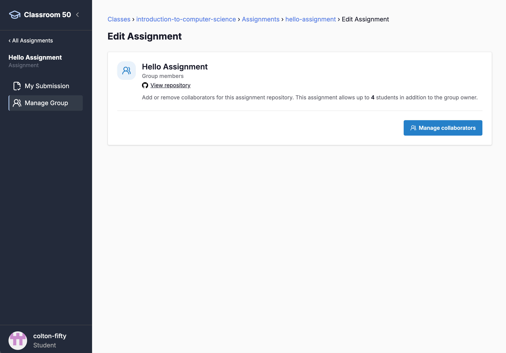
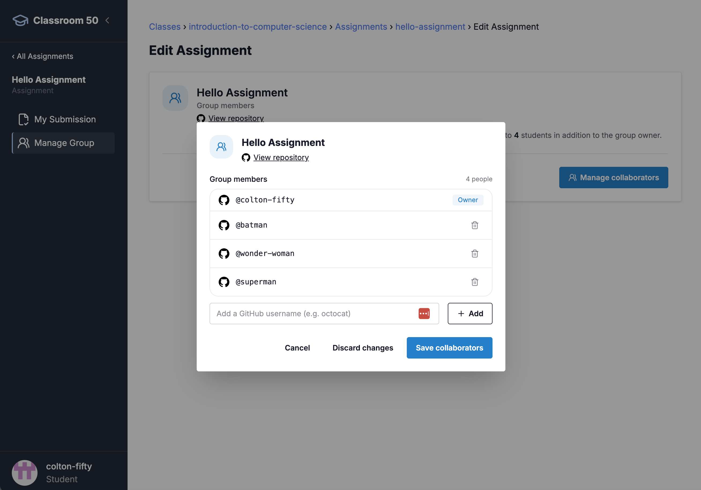

# Projeto Semestral SSC — VidaPlus (Sistema de Gestão em Saúde)

**Disciplina:** Segurança de Sistemas Computacionais (SSC)
**Câmpus:** IFSul — Sapucaia do Sul · Tecnologia em Análise e Desenvolvimento de Sistemas
**Professor:** Dr. Alex Mulattieri Suarez Orozco
**Modalidade:** projeto em grupos de 3–4 alunos conduzido ao longo de 16 semanas (3h/aula)

---

## 1. A ideia central

A disciplina inteira gira em torno de **um único projeto vivo**. Em vez de teoria
solta seguida de exercícios, o grupo recebe um **software real e inseguro** — o
**VidaPlus**, um sistema de gestão de clínica que **nunca passou por revisão de
segurança** — e tem a missão de **adequá-lo à realidade atual** de segurança e
privacidade, seguindo um **SSDLC (Secure Software Development Lifecycle)** completo.
O sistema roda em **stack atual** (Java 21 / Spring Boot 3 · React 19 / Vite · MySQL 8.4);
o "legado" é o **contexto** (falta de cuidado com segurança e LGPD), não a tecnologia.

O conteúdo teórico é **puxado pela demanda do projeto** (*just-in-time learning*):
quando a etapa exige modelar ameaças, a aula é threat modeling; quando exige
tratar dados pessoais, a aula é LGPD; quando exige provar que a correção funciona,
a aula é SAST/DAST/SCA no CI. O aluno aprende a teoria **no momento em que precisa
aplicá-la**, o que fixa o conhecimento e evita o antipadrão "segurança no fim".

> **Frase-síntese da disciplina:**
> *Requisito bem-feito = ativo + ameaça + atributo + critério verificável + rastreabilidade.*

> ⚠️ **Foco e natureza do projeto.** O foco da disciplina é **SSDLC + LGPD + privacidade**,
> **não** desenvolvimento. O VidaPlus (código, banco e pipeline) é um **cenário de
> simulação** — um "projeto real em escala acadêmica" — para os alunos **vivenciarem a
> aplicação da teoria**. O que se avalia é o **processo seguro** (classificação de dados,
> requisitos+LGPD, threat model STRIDE **e** LINDDUN, Privacy by Design, RIPD/DPIA,
> rastreabilidade, verificação, resposta a incidente). A correção de código entra apenas
> como **prova de conceito** — poucos controles, feitos ponta-a-ponta, para gerar evidência
> de que o grupo sabe fechar o fio ativo→ameaça→requisito→controle→teste→evidência.
> **Não é preciso corrigir tudo**; o restante é **analisado e planejado**.

---

## 2. O software (VidaPlus)

Um sistema de clínica que **nunca passou por revisão de segurança** — o "legado" é o
**contexto narrativo**, não a tecnologia. A stack é **atual**; as **falhas de segurança e
privacidade** estão plantadas no **código e no design** (não em versões obsoletas), o que
é realista: sistemas modernos também têm SQLi, IDOR, MD5, segredos no código e XSS.

| Camada | Stack (atual) | Papel |
|--------|---------------|-------|
| Frontend | **React 19 + Vite** | Portal web (paciente, médico, recepção, laboratório, admin) |
| Backend | **Java 21 + Spring Boot 3** | API REST |
| Banco | **MySQL 8.4** | Dados cadastrais, prontuários, exames, logs |
| Orquestração | **Docker Compose** | Sobe tudo com um comando |

O VidaPlus lida com **dados sensíveis de saúde** — PII sob a **LGPD art. 11** — e por
isso é o pano de fundo ideal para **Privacy by Design** e **LINDDUN**.

---

## 3. Estrutura do repositório

```
projeto-vidaplus/
├── README.md                        ← este arquivo
├── docs/                            ← desenho da disciplina e do projeto
│   ├── 00-visao-geral.md            visão, contexto do legado, papéis
│   ├── 01-plano-disciplina-ssdlc.md SSDLC ↔ teoria ↔ 16 semanas
│   ├── 02-lgpd.md                   LGPD embutida no SSDLC
│   ├── 03-privacy-by-design-linddun.md  PbD + LINDDUN
│   ├── 04-catalogo-funcionalidades.md   funcionalidades por criticidade
│   ├── 05-pacotes-trabalho-estudantes.md pacotes de trabalho por grupo
│   ├── 06-pipeline-cicd.md          gates de segurança ↔ fases do SSDLC
│   ├── 07-rubrica-avaliacao.md      avaliação alinhada às fases
│   ├── 08-setup-grupos.md           passo a passo para os grupos começarem
│   ├── 09-dossie-template.md        visão geral do dossiê (arquivo a preencher em entregaveis/)
│   ├── 10-glossario.md              consulta rápida dos termos da disciplina
│   ├── 11-apostila.md               material de estudo em texto (acompanha os slides)
│   ├── 12-exemplo-dossie-preenchido.md  dossiê completo de exemplo (pacote 5) — o nível esperado
│   └── 13-gate-bloqueante-do-grupo.md   (opcional) como tornar bloqueante o gate do seu grupo
├── entregaveis/                    ← o que o grupo preenche e entrega
│   └── DOSSIE.md                    dossiê de segurança e privacidade (preencher nas fases)
├── aulas/                          ← slides .pptx (template IFSul), um por aula
├── legacy-app/                      ← o software a ser corrigido
│   ├── docker-compose.yml
│   ├── db/         schema.sql + seed.sql (MySQL)
│   ├── backend/    Java Spring Boot (Maven)
│   └── frontend/   React
├── .github/workflows/              ← pipeline CI/CD (GitHub Actions)
│   └── ssdlc-pipeline.yml
└── security/                       ← configs dos scanners (ZAP, Semgrep, etc.)
```

---

## 4. Formar o grupo no Classroom 50

O professor compartilha um **link de convite** (Classroom 50). O repositório do grupo é
**um só, compartilhado** — não um por pessoa. Para formá-lo:

1. **Só o líder** do grupo aceita o convite e **cria o repositório compartilhado** — fica como
   **owner** (dono). Os demais **não** clicam no link de aceite (senão criariam outro repo).
2. O **owner** adiciona os demais como **colaboradores**: na página do assignment clique no
   **lápis de edição** (canto superior direito) para abrir **Edit Assignment**:

   

3. Clique em **Manage collaborators**:

   

4. Na janela **Group members**, o owner digita o **usuário do GitHub** de cada colega em
   *Add a GitHub username*, clica **+ Add** e, ao terminar, **Save collaborators**. (Este
   assignment permite até **4** estudantes além do owner.)
5. Cada colega adicionado **aceita o convite da organização** da turma (e-mail do GitHub ou
   `github.com/settings/organizations`) — só então ganha acesso ao repositório. Se ao adicionar
   o usuário "não for encontrado", é porque o colega ainda não está na organização.

Depois, **cada integrante clona** o mesmo repositório para trabalhar — passo a passo (com clone
e autenticação) em [docs/08 §1](docs/08-setup-grupos.md).

---

## 5. Como rodar o legado

Já **dentro da pasta do repositório do grupo** (depois de cloná-lo — passo a passo, com clone
e autenticação, em [docs/08 §1](docs/08-setup-grupos.md)) e com o **Docker** instalado:

```bash
cd legacy-app
docker compose up --build
# Frontend:  http://localhost:4200
# API:       http://localhost:8080
# MySQL:     localhost:3306  (vidaplus / senha em docker-compose.yml — de propósito!)
```

Usuários de teste, endpoints e as falhas exploráveis estão em
[legacy-app/README.md](legacy-app/README.md).

---

## 6. O fio condutor (SSDLC → teoria → entrega)

*(Disciplina de 16 semanas, 3h/aula — teoria e prática dentro da mesma aula.)*

| Fase do SSDLC | Semanas | Teoria puxada pela demanda | Entrega do grupo (artefato) |
|---------------|:-------:|----------------------------|------------------|
| 0 · Kickoff & inventário do legado | 1 | SSDLC, cenário de ameaças, risco de legado | Inventário de ativos + classificação de dados |
| 1 · Requisitos & conformidade | 2–3 | Eng. de requisitos de segurança, **LGPD**, ASVS | Requisitos de segurança + base legal |
| 2 · Privacidade & threat modeling | 4–5 | **Privacy by Design, LINDDUN**, STRIDE, DFD | DFD + LINDDUN + STRIDE + árvore de ataque + RIPD |
| 3 · Projeto seguro | 6 | Arquitetura segura, cripto, authn/authz, DoD | Especificação + Definition of Done |
| 4 · Remediação (prova de conceito) | 7–10 | OWASP Top 10, secure coding do controle escolhido | **1–2 controles corrigidos ponta-a-ponta** + plano de remediação do restante |
| 5 · Verificação | 11–12 | SAST/DAST/SCA, testes de segurança | Testes + evidências no CI |
| 6 · Release & DevSecOps | 13 | Pipeline, supply chain, gestão de segredos | Pipeline como **gerador de evidência** |
| 7 · Operação & resposta | 14 | Logging, monitoração, resposta a incidentes, ANPD | Trilha de auditoria + plano de resposta (art. 48) |
| 8 · Retro & auditoria | 15 | Métricas, risco residual, melhoria contínua | Matriz de rastreabilidade + métricas |
| — · Defesas | 16 | — | Defesa final (fecha o fio ao vivo) |

Detalhe completo em [docs/01-plano-disciplina-ssdlc.md](docs/01-plano-disciplina-ssdlc.md).
