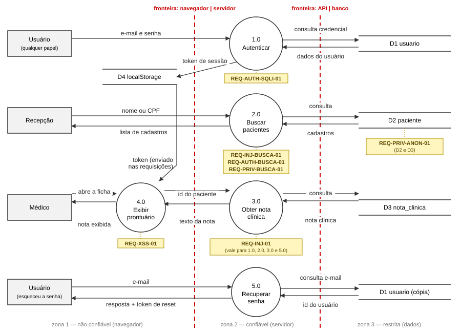

# 12 · Exemplo de dossiê preenchido — pacote 5 (Injeção & Anonimização de Dados)

> **Exemplo de dossiê preenchido.** Este é o dossiê de um grupo que trabalhou o **pacote 5 —
> Injeção & Anonimização de Dados** ([docs/05](05-pacotes-trabalho-estudantes.md)), pacote que
> **não foi atribuído** a nenhum grupo nesta turma. Use-o para ver **o nível de detalhe
> esperado** em cada seção do seu [`entregaveis/DOSSIE.md`](../entregaveis/DOSSIE.md): ativos
> concretos, requisitos nas duas formas (*shall* + `.feature`), ameaças específicas, decisões
> justificadas, evidência para cada "Verificado".
>
> Este grupo é **fictício**: os números de PR e de execução do pipeline e os arquivos de evidência
> citados são **ilustrativos** e não existem no repositório. Eles mostram **como** registrar a
> evidência. No seu dossiê, aponte para os **seus** PRs e execuções reais. Os **ataques** feitos
> no legado (com `curl`, no navegador, no banco), por outro lado, são **reais**: rode-os no seu
> VidaPlus e confira o que acontece.
>
> ⚠️ **Não copie.** O seu pacote tem outros ativos, outras ameaças e outro recorte; o que se
> avalia é o **seu** fio (ativo → ameaça → requisito → controle → teste → evidência), e você
> vai defendê-lo ao vivo.

### Como ler este exemplo

- **As caixas 💡 são comentários do professor para você.** Explicam por que o grupo fez de um
  jeito e não de outro. Elas **não fazem parte do dossiê**: no seu, não escreva caixas assim.
- **Este grupo errou, achou o erro e corrigiu.** Repare que vários achados importantes só
  apareceram **depois** da correção, quando o grupo atacou o sistema de novo (§7). Isso é normal
  e esperado: um dossiê bom registra o que descobriu e o que ainda falta, sem esconder.
- **Duas diferenças entre este exemplo e o trabalho da sua turma:**
  1. Este grupo **implementou** também a funcionalidade de criação (F-06). No seu grupo, a
     criação é **só especificada**: regras no dossiê, `.feature` com `@analise` e linha no plano
     de remediação. Implementa-se apenas o **P0**, na aula de laboratório guiada.
  2. Este grupo escreveu um teste `@security` novo (`busca-injecao.feature`). No seu grupo, o
     teste do P0 **já vem pronto**. Vocês podem acrescentar cenários a ele, mas não precisam.
- **Para fazer o dossiê do seu grupo, siga o roteiro da pasta [`roteiros/`](../roteiros/README.md)**:
  há um roteiro por fase, escrito para as funcionalidades do **seu** pacote. Este exemplo é a
  referência de qualidade que os roteiros citam a cada passo.

---

## 0. Identificação

- **Grupo:** Grupo Exemplo — pacote 5 (Injeção & Anonimização de Dados)
- **Integrantes:** Integrante 1, Integrante 2, Integrante 3, Integrante 4
- **Liderança por fase:** 0 → Integrante 1 (Segurança) · 1 → Integrante 2 (DPO) · 2a → Integrante 1 ·
  2b → Integrante 2 · 3 → Integrante 3 · 4 → Integrante 4 (Dev) · 5 → Integrante 3 (DevSecOps) · 6 → Integrante 3 ·
  7 → Integrante 1 · 8 → Integrante 2.
- **Pacote:** F-01 (P0 🛠️, recorte: classe de injeção), F-06 (P0 ✨⚖️, recorte:
  anonimização/pseudonimização), F-13 (P1 🛠️), F-14 (P1 🛠️) + F-10/F-21.
- **Controles implementados:** **F-01 + F-13** (uma única correção da classe:
  REQ-INJ-01) e **F-06** (REQ-PRIV-ANON-01).

---

## 1. Fase 0 — Inventário & classificação de dados

**Fluxos críticos:**
1. **Login** — o usuário informa e-mail e senha e recebe acesso conforme o seu papel.
   **Crítico** (credencial: quem entra com ela age em nome de outra pessoa).
2. **Busca de pacientes** — a recepção digita nome ou CPF e recebe a lista de cadastros. A
   busca **não pede login** e devolve CPF, religião e renda. **Crítico.**
3. **Prontuário (nota clínica)** — médico ou paciente abre a ficha e lê a nota clínica, um
   texto livre escrito por profissionais. A API também entrega a nota **sem pedir login**, a quem
   souber o número do paciente. **Crítico** (dado de saúde).
4. **Recuperação de senha** — o usuário informa o e-mail e recebe um código para trocar a senha.
   *(Acrescentado na Fase 4: ver a nota no §3.)*
5. (Ausente) **Fim de vida do dado** — nenhum dado de paciente é descartado ou anonimizado,
   nem de quem já deixou a clínica.

| Ativo / Dado | Fluxo | Nível | Atributo | Quem demanda | Base legal | Observação |
|---|---|:-:|---|---|---|---|
| Credenciais (`usuario`: e-mail, senha, papel) | login, recuperação de senha | Crítico | C + I | segurança | art. 7º, V (a conta existe para prestar o serviço) | quem obtém a credencial age em nome do usuário; a senha é guardada em MD5, sem sal |
| Segredos do sistema (chave que assina os tokens, senha do banco) | toda a API | Crítico | C | segurança | — (não é dado pessoal) | estão gravados no código: quem lê o repositório cria um token de qualquer usuário ou entra direto no banco (F-10, §8) |
| Cadastro do paciente (`paciente`: nome, CPF, contato) | busca de pacientes | Crítico | C | titular, jurídico | art. 7º, V | a busca devolve o cadastro completo e nem pede login |
| Religião, estado civil, renda (`paciente`) | busca de pacientes | Crítico (religião é dado sensível) | C | ninguém | — (sem finalidade) | coletados, mas nenhum fluxo usa |
| Data de nascimento, endereço | cadastro | Confidencial | C | jurídico | art. 7º, V | sozinhos não identificam ninguém; junto com outros dados, apontam uma pessoa |
| Nota clínica | prontuário | Crítico | C + I | médico | art. 11, II, "f" | dado de saúde em texto livre: pode conter qualquer informação; a API a entrega sem login |
| Resultado de exame | consulta de exame | Crítico | C + I | negócio, titular | art. 11, II, "f" | dado de saúde, também em texto livre; fica guardado para sempre, sem prazo de descarte |
| Laudo em PDF (arquivo) | consulta de exame | Crítico | C | titular | art. 11, II, "f" | arquivo com o nome do paciente e o resultado impressos, numa pasta pública do servidor web, com nome previsível (`laudo-101.pdf`) |
| Token de sessão (`localStorage`) | sessão | Crítico | C | segurança | art. 7º, V | fica no navegador e não expira: quem copia o token usa a conta |

> 💡 **Duas lições desta tabela.**
> **(1) "Base legal" não é "artigo que fala de segurança".** A base legal responde *"por que a
> clínica pode tratar este dado?"* — são as hipóteses do art. 7º (dado comum) e do art. 11 (dado
> sensível). O art. 46 é outra coisa: é o **dever de proteger** o dado. Ele aparece nos
> requisitos (§2), não nesta coluna.
> **(2) Ativo não é só dado pessoal.** A chave que assina os tokens não identifica ninguém, mas
> quem a tem vira qualquer usuário. Se ela ficar fora do inventário, também fica fora da árvore
> de ataque — e foi o que quase aconteceu aqui.

---

## 2. Fase 1 — Requisitos de segurança & LGPD

### Forma 1 — Declarações *shall* (agnósticas, aqui no dossiê)

| Requisito | Declaração *shall* | Prior. | Base legal / ASVS | Ameaça (em palavras) |
|---|---|:-:|---|---|
| REQ-INJ-01 | O sistema **deve** tratar toda entrada externa usada em consulta ao banco exclusivamente como dado, nunca como parte do comando, em qualquer funcionalidade. | P0 | art. 46 · ASVS V5.3.4 | alguém usa o que digita num campo para alterar a consulta ao banco |
| REQ-AUTH-SQLI-01 | O sistema **deve** rejeitar tentativas de autenticação com conteúdo de injeção, sem autenticar e sem emitir credencial de sessão. | P0 | art. 46 · ASVS V5.3.4 | entrar no sistema como outro usuário sem saber a senha |
| REQ-INJ-BUSCA-01 | A busca de pacientes **deve** devolver somente cadastros que correspondam ao termo informado, qualquer que seja o conteúdo do termo. | P0 | arts. 11, 46 · ASVS V5.3.4 | copiar o cadastro de todos os pacientes pela busca, sem login |
| REQ-AUTH-BUSCA-01 | A busca de pacientes **deve** estar disponível somente para usuários autenticados. *(Acrescentado na Fase 5 — ver §7.)* | P0 | arts. 11, 46 · ASVS V4.1 | qualquer pessoa na internet usa a busca e copia o cadastro de todos, sem precisar de nenhuma técnica |
| REQ-PRIV-BUSCA-01 | A busca **deve** devolver apenas os campos necessários para localizar o cadastro, com documento mascarado; **deve** exigir termo mínimo e tratar como texto comum os caracteres que o banco interpreta como curinga. | P1 | art. 6º, III | uma busca bem específica (nome + CPF) expõe tudo de uma única pessoa; uma busca por `%` devolve todos |
| REQ-XSS-01 | O sistema **deve** exibir conteúdo clínico digitado por usuários como texto, sem executar marcação, e **deve** instruir o navegador a não executar código embutido nem enviar dados para origens não autorizadas. | P1 | art. 46 · ASVS V5.3.3, V14.4.3 | o texto de uma nota clínica fazer o navegador de quem a lê executar algo |
| REQ-PRIV-ANON-01 | Ao fim do prazo de guarda, o sistema **deve** tornar os dados do titular anonimizados de forma que ele não possa ser reidentificado por meios razoáveis: remover identificadores diretos, generalizar quase-identificadores e eliminar texto livre e arquivos. | P0 | arts. 5º III, 12, 16 IV · ASVS V8.3.8 | dados de ex-pacientes vazarem anos depois, ou alguém descobrir de quem é um registro "anônimo" |
| REQ-PRIV-PSEUDO-01 | Onde o dado precisar continuar vinculável ao titular (auditoria, operação), o sistema **deve** usar identificador opaco, mantendo a chave de reidentificação separada e restrita. | P1 | art. 13 §4 | um registro interno (ex.: log) permitir identificar o paciente |
| REQ-LOG-01 | O sistema **deve** registrar cada busca de pacientes e cada tentativa de login — com data e hora, quem fez (ou a origem, se não houver usuário) e o resultado — **sem** registrar o termo pesquisado nem a senha. | P1 | arts. 37, 46 · ASVS V7.1 | um ataque que dá certo não deixa rastro, e depois ninguém sabe o que vazou nem de quem |

**Nível ASVS alvo:** **L2** — **justificativa:** na Fase 0 classificamos como **Crítico** o
resultado de exame, a nota clínica e o cadastro (dado de saúde, art. 11; religião é dado
sensível). O L1 cobre só o que se verifica de fora do sistema e não basta para dado sensível; o
L2 é o nível indicado para esse tipo de dado. O L3 fica para os módulos mais críticos do
VidaPlus, como o acesso ao laudo, que não estão no nosso pacote. Os requisitos do pacote vêm
principalmente dos capítulos **V5** (validação e tratamento de entrada) e **V8** (proteção de
dados). **Versão usada: ASVS 4.0.3** (por exemplo, V5.3.4 = consultas parametrizadas). A versão
5.0, de 2025, renumerou os capítulos; por isso o número sempre vem acompanhado da versão.

> 💡 **Um requisito pode nascer depois da Fase 1.** O REQ-AUTH-BUSCA-01 e o REQ-LOG-01 surgiram
> nas Fases 5 e 7, quando o grupo descobriu coisas que não tinha visto antes. Isso não é falha do
> processo: é o processo funcionando. Quando acontecer com você, volte à tabela, acrescente o
> requisito e diga de onde ele veio.

### Forma 2 — Cenários Gherkin (`.feature`, vinculados à tecnologia)

| Requisito | `.feature` | Estado |
|---|---|---|
| REQ-INJ-01 | `sqli.feature` e `busca-injecao.feature` (a tag `@REQ-INJ-01` está nos dois: o requisito da classe é provado em cada ponto de entrada) | `@security` |
| REQ-AUTH-SQLI-01 | `sqli.feature`: o cenário que já vinha no template + 2 cenários que acrescentamos com outras formas do mesmo ataque (ver Anexo A) | `@security` |
| REQ-INJ-BUSCA-01 | `busca-injecao.feature` | `@security` |
| REQ-AUTH-BUSCA-01 | `busca-acesso-analise.feature` | `@analise` |
| REQ-PRIV-BUSCA-01 | `busca-minima-analise.feature` | `@analise` |
| REQ-XSS-01 | `xss-analise.feature` | `@analise` |
| REQ-PRIV-ANON-01 | `anonimizacao-analise.feature` | `@analise` (*ver nota*) |
| REQ-PRIV-PSEUDO-01 | `pseudonimizacao-analise.feature` | `@analise` |
| REQ-LOG-01 | `registro-analise.feature` | `@analise` |

> **Nota — REQ-PRIV-ANON-01:** este requisito **foi implementado** (é a nossa PoC do F-06), mas
> o `.feature` ficou `@analise` porque o cenário precisa de pacientes com datas de mais de 20
> anos no banco, e os passos prontos não montam esses dados. A prova executável dele é um teste
> escrito na implementação e registrado na §7, que roda no mesmo gate de segurança.

---

## 3. Fase 2a — Threat modeling (STRIDE)

**DFD do recorte (login, busca de pacientes, prontuário e recuperação de senha):**



> **Nota — o processo 5.0 entrou depois.** A recuperação de senha não estava no recorte da
> primeira versão do DFD. Na Fase 4, ao procurar todos os pontos de injeção (§6.1), achamos um
> no `UsuarioDao.porEmail`, usado por ela. Voltamos aqui, desenhamos o processo e fizemos o
> STRIDE dele. O D1 aparece duas vezes no desenho só para as setas não se cruzarem: é a mesma
> tabela.

| Elemento | S | T | R | I | D | E | Ameaça concreta | Requisito |
|---|:-:|:-:|:-:|:-:|:-:|:-:|---|---|
| Usuário (entidade externa) | X | | X | | | | Atacante se faz passar pelo usuário, com senha roubada ou com injeção de SQL no login, e age no sistema em nome dele (S). O usuário nega que tomou uma ação, como uma alteração de cadastro, porque nada é registrado (R). | REQ-AUTH-SQLI-01 (via injeção); senha roubada → F-01, recorte de credencial; R → F-05 — outros pacotes (transferidas) |
| Recepção (entidade externa) | X | | X | | | | Mesmas ameaças do usuário, mas com o alcance da recepção, que busca dados pessoais de pacientes | idem |
| Médico (entidade externa) | X | | X | | | | Mesmas ameaças do usuário, mas com o alcance do médico, que lê e altera dados clínicos | idem |
| 1.0 Autenticar (`UsuarioDao.autenticar`) | X | X | | X | X | X | O e-mail digitado entra no comando SQL e muda o que ele faz (T). Com `' -- ` no fim do e-mail, o atacante entra como qualquer usuário sem a senha (S), inclusive como ADMIN (E). Com `UNION`, lê outras tabelas; e a mensagem de erro devolvia o próprio SQL ao atacante (I). Com `SLEEP`, prende o login por segundos — testamos: uma única requisição levou 18 s (D) | REQ-AUTH-SQLI-01, REQ-INJ-01 |
| 2.0 Buscar pacientes (`PacienteDao.buscar`) | | X | | X | X | X | O termo digitado muda o comando (T). Com `' OR '1'='1` ou `UNION`, devolve todos os pacientes e até o e-mail e o hash de senha da tabela `usuario` (I). Com `SLEEP`, prende a requisição (D). A busca não pede login: qualquer pessoa na internet tem o poder da recepção (E) — e, mesmo sem injeção, `q=` ou `q=%` devolve a base inteira (achado da Fase 5, §7) | REQ-INJ-BUSCA-01, REQ-AUTH-BUSCA-01, REQ-PRIV-BUSCA-01 |
| 3.0 Obter nota clínica (`PacienteDao.notaDoPaciente`/`porId`) | | X | | X | | X | As consultas da nota e do cadastro montam o SQL concatenando o id, em vez de passá-lo como parâmetro. Hoje só chega número (o id é `long` e o Spring recusa o que não é número — testamos `/api/pacientes/1abc/notas`: resposta 400), então não há como injetar comando. A proteção é acidental: se o id virar texto (por exemplo, ao trocar os ids sequenciais por UUID), a consulta passa a aceitar injeção e permite ler (I) ou alterar (T) dados do banco, sem que ninguém mexa no SQL. Além disso, a nota é entregue sem login: quem souber o número do paciente lê um dado de saúde (E) | REQ-INJ-01; sem login → V-19, outro pacote (transferida) |
| 4.0 Exibir prontuário (`Prontuario.jsx`) | X | X | | X | | X | stored XSS: `` envia o JWT a `coleta.attacker.example` | REQ-XSS-01 |
| 5.0 Recuperar senha (`UsuarioDao.porEmail`) | X | X | | X | | | O e-mail digitado muda o comando (T). A resposta diz "encontrado" ou "não cadastrado": isso revela quem tem conta e, junto com a injeção, permite extrair dados do banco, uma pergunta de sim ou não por vez (I). O código de troca de senha é previsível (número do usuário + horário), e com ele dá para trocar a senha de outra pessoa (S) | REQ-INJ-01; enumeração e código previsível → F-12, outro pacote (transferida) |
| D1 usuario | | | X | X | | | Por `UNION` na busca, o atacante lê e-mail e hash de senha de todos os usuários (I) — e o hash é MD5 sem sal, que se quebra rápido. Alterações em usuários não ficam registradas (R) | REQ-INJ-BUSCA-01 (leitura); MD5 → F-01, recorte de credencial; R → F-05 — outros pacotes |
| D2 paciente | | | | X | | | Pela busca (com ou sem injeção) ou por `UNION` no login, o atacante lê o cadastro de todos os pacientes (I). **Alterar ou apagar (T, D) não é possível por essas injeções:** o driver do MySQL executa um comando por vez e as consultas vulneráveis são só de leitura — testamos `'; UPDATE paciente ...` e recebemos erro de sintaxe. Mas o usuário da aplicação no banco tem todos os privilégios: se surgir uma injeção num comando de escrita, o estrago é total (menor privilégio: §6.2) | REQ-INJ-01, REQ-AUTH-BUSCA-01 |
| D3 nota_clinica | | | | X | | | Por `UNION` (na busca ou no login), o atacante lê o texto das notas (I). Alterar (T) não é possível por essas injeções, pelo mesmo motivo do D2 | REQ-INJ-01 |
| D4 localStorage | | | | X | | | token de sessão legível por qualquer script da página; como não expira, um token vazado compromete a conta indefinidamente | REQ-XSS-01 |
| Fluxo "e-mail e senha" (zona 1 → zona 2) | | X | | X | | | a credencial cruza a fronteira zona 1 → zona 2 em HTTP, sem TLS: quem está no caminho da rede captura e-mail e senha e passa a ter acesso à conta inteira (I). Alterar a credencial no caminho (T) tem pouco efeito prático; interrupção (D) só impede aquele login. O tratamento da entrada é ameaça do processo 1.0 | TLS + HSTS — outro pacote (V-13); REQ-AUTH-SQLI-01 (ligação com o 1.0) |
| Fluxo "id do paciente" (4.0 → 3.0, zona 1 → zona 2) | | X | | X | | | o pedido cruza a fronteira zona 1 → zona 2 em HTTP, sem TLS: quem está no caminho da rede vê qual paciente o médico consulta (I) ou troca o id para que ele leia a nota de outro paciente sem perceber (T). Como o id vem da zona 1, o próprio usuário também pode trocá-lo — essa ameaça se realiza no 3.0, que precisa verificar se quem pede pode ver aquele paciente. Interrupção (D) tem impacto baixo | TLS + HSTS — outro pacote (V-13); autorização no 3.0 — outro pacote (V-19) |
| Fluxo "texto da nota" (3.0 → 4.0, zona 2 → zona 1) | | X | | X | | | dado de saúde cruza a fronteira zona 2 → zona 1 em HTTP, sem TLS: quem está no caminho da rede lê a nota (I) ou a altera antes de chegar ao médico (T). O fluxo também leva texto livre, não confiável, para dentro da zona 1 — a ameaça se realiza no 4.0. Interrupção (D) tem impacto baixo: só impede a leitura de uma nota | TLS + HSTS — outro pacote (V-13); REQ-XSS-01 (ligação com o 4.0) |
| Fluxos de consulta (zona 2 → zona 3) | | X | | X | | | a conexão com o banco é feita sem TLS (`useSSL=false` na URL de conexão, no `docker-compose.yml`): quem está na rede entre a API e o banco lê as consultas e os resultados (I) ou os altera (T). O SQL montado com o texto digitado é ameaça dos **processos** (1.0, 2.0, 3.0 e 5.0), não do fluxo | TLS na conexão com o banco — outro pacote (V-13) |
| Fluxo "lista de cadastros" (2.0 → Recepção) | | | | X | | | filtro estreito isola 1 pessoa com tudo | REQ-PRIV-BUSCA-01 |

> 💡 **Teste a sua afirmação antes de escrevê-la.** A primeira versão desta tabela dizia que a
> injeção no login permitia "alterar os pacientes e apagar o banco inteiro". Parecia óbvio — e
> estava errado. O grupo tentou (`'; UPDATE ...`) e o banco recusou. A ameaça real de
> disponibilidade era outra, que ninguém tinha pensado: o `SLEEP`. Quando a tabela diz o que a
> falha permite, diga **o que você conseguiu fazer** no VidaPlus, não o que "uma injeção de SQL
> costuma fazer".

**Árvore de ataque — "extrair a base de pacientes":**

```
OBJETIVO: copiar nome, CPF e dados sensíveis de todos os pacientes                        (OR)
├── 1. Busca sem login com termo vazio ou "%"   custo trivial · SEM conta · SEM injeção     → REQ-AUTH-BUSCA-01, REQ-PRIV-BUSCA-01
├── 2. SQLi na busca: q=' OR '1'='1             custo trivial · SEM conta                   → REQ-INJ-BUSCA-01
├── 3. SQLi UNION na busca: lê usuario.email/senha_hash (MD5)  custo baixo                  → REQ-INJ-BUSCA-01
├── 4. Virar ADMIN/recepção                                                                 (OR)
│      ├── SQLi no login com ' --               custo trivial                               → REQ-AUTH-SQLI-01
│      ├── Forjar um token de ADMIN: a chave que assina os tokens está no código
│      │                                        custo trivial para quem lê o repositório    → F-10 (plano, §8)
│      └── XSS na nota rouba o JWT de um médico custo médio (precisa gravar uma nota,
│                                               e o legado não tem tela para isso)          → REQ-XSS-01
├── 5. Ler direto do banco                                                                  (AND)
│      ├── alcançar a porta 3306, aberta para fora do container   custo baixo (mesma rede)
│      └── usar a senha gravada no docker-compose.yml             custo trivial             → F-10 (plano, §8)
├── 6. Busca legítima iterada (A, B, C...)      custo médio · com o REQ-AUTH-BUSCA-01,
│                                               passa a exigir conta                        → REQ-PRIV-BUSCA-01
└── 7. Base "antiga" vazada no futuro: dados nunca anonimizados                             → REQ-PRIV-ANON-01
```

Leitura: `(OR)` = qualquer um dos ramos basta; `(AND)` = o atacante precisa de todos os itens do
ramo ao mesmo tempo.

> 💡 **Comece a árvore pelo caminho mais fácil, não pela falha famosa.** O ramo 1 não usa técnica
> nenhuma: é só usar a busca do jeito que ela foi feita. É o mais barato de todos — e não existia
> na primeira versão desta árvore, que começava pela injeção de SQL "porque o pacote é de
> injeção". Pergunte sempre: *qual é o jeito mais fácil de chegar a este objetivo?*

---

## 4. Fase 2b — Privacidade: LINDDUN + Privacy by Design + RIPD

### 4.1 LINDDUN-per-element

As colunas seguem a sigla: **L**inking (vinculação), **I**dentifying (identificação),
**N**on-repudiation (não-repúdio), **D**etecting (detecção), **D**ata disclosure (divulgação),
**U**nawareness (desconhecimento), **N**on-compliance (não-conformidade).

| Elemento | L | I | N | D | D | U | N | Ameaça concreta | Controle/PET | Requisito |
|---|:-:|:-:|:-:|:-:|:-:|:-:|:-:|---|---|---|
| Busca (mesmo **sem** SQLi) | | X | | | | | | nome + CPF isolam 1 pessoa e devolvem o registro completo (I.2.3) — parametrizar não resolve | campos mínimos, máscara, termo mínimo | REQ-PRIV-BUSCA-01 |
| Busca | | | | X | | | | pesquisar um CPF e receber 1 resultado (ou nenhum) revela **se a pessoa é paciente** da clínica — o que já é informação ligada à saúde. Hoje qualquer pessoa, sem login, pode fazer essa pergunta | só usuário autenticado busca; cada busca registrada | REQ-AUTH-BUSCA-01, REQ-LOG-01 |
| Busca | | | | | X | | | volume: devolve religião e renda de todos (DD.2.1) | minimização (F-15) | outro pacote (F-15) |
| Paciente anonimizado | | X | | | | | | trocar nome por `ANON-1` e manter CPF/nascimento completo = pseudonimização — reidentificável | remover diretos + generalizar quase-identificadores | REQ-PRIV-ANON-01 |
| Paciente anonimizado | X | | | | | | | `paciente.id` continua ligando exames e eventos de auditoria do mesmo titular (L) | aceitável **só** se nenhum atributo do conjunto reidentificar; id não é publicado | REQ-PRIV-ANON-01 |
| Texto livre (nota clínica **e** resultado do exame) | | X | | | | | | texto livre pode conter nome/CPF — anonimizar colunas não basta. O resultado do exame parece "dado clínico", mas no legado também é texto livre | eliminar o texto livre ao anonimizar | REQ-PRIV-ANON-01 |
| Arquivo do laudo (PDF) | | X | | | | | | o PDF tem o nome do paciente e o resultado impressos; apagar o caminho no banco **não apaga o arquivo**, que continua baixável no endereço previsível | apagar o arquivo junto com o registro | REQ-PRIV-ANON-01 (depende do F-08 — §6.1) |
| Datas (exame, atendimento) | | X | | | | | | a data exata de uma consulta, junto com o ano de nascimento, pode apontar uma única pessoa numa clínica pequena | generalizar para o ano | REQ-PRIV-ANON-01 |
| Auditoria | | X | | | | | | log com CPF identificaria mesmo após anonimizar o cadastro | `user_id` opaco (pseudônimo) | REQ-PRIV-PSEUDO-01 |
| Banco e cópias de segurança | | | | | | | X | retenção infinita (Nc) — e anonimizar o banco não alcança os backups antigos | anonimização ao fim da guarda + prazo de descarte dos backups | REQ-PRIV-ANON-01 (backups: plano, §6.2) |
| Titular | | | | | | X | | o paciente não é informado de quanto tempo os dados ficam guardados nem de que serão anonimizados | aviso de privacidade | outro pacote (F-04, transparência e consentimento) |

> 💡 **Supressão não é anonimato.** A tentação é pensar a anonimização como "apagar as colunas
> com nome e CPF". As linhas acima mostram por que não basta: o dado escapa pelo texto livre, por
> um arquivo fora do banco, por datas e por cópias de segurança. Para cada dado do seu pacote,
> pergunte: *onde mais existe uma cópia dele?*

### 4.2 Privacy by Design (decisões)

| Princípio | Aplicação | Evidência |
|---|---|---|
| Proativo | inventário de **todos** os pontos de injeção antes de corrigir um | §6.1 |
| Privacidade como padrão | `?` sempre; `JdbcTemplate` em vez de `Statement`; busca só com login (plano, REQ-AUTH-BUSCA-01) | `PacienteDao`; §6.2 |
| Embarcada no design | anonimização com regras explícitas por tipo de atributo (direto/quase/texto livre/arquivo) | `RetencaoService` |
| Soma positiva | a correção da injeção não piorou a busca: a recepção continua encontrando pacientes pelo nome, sem bloqueio de caracteres nem exigência de CPF exato | `busca-injecao.feature`, cenário "busca legítima continua funcionando" (busca "Silva" e encontra a Ana Silva) |
| Ponta a ponta | o dado do paciente é protegido em todo o ciclo de vida: na coleta e no uso (consulta parametrizada), no armazenamento e no fim da guarda (anonimização, que inclui apagar o texto livre). **Lacunas assumidas:** o arquivo PDF depende do F-08, os backups estão no plano, e a proteção em trânsito (TLS) é de outro pacote (V-13) | §6.1 (Controles 1 e 2); §6.2 |
| Transparência | política de anonimização descrita no aviso de privacidade (plano) | — |
| Respeito ao usuário | o sistema faz por conta própria o que interessa ao titular: ao fim do prazo de guarda, o ex-paciente deixa de ser identificável, sem precisar pedir. Os pedidos feitos pelo próprio titular (acesso, correção, eliminação a pedido) são de outros pacotes (F-09, F-19 e o outro recorte do F-06) | `AnonimizacaoTest` |

### 4.3 RIPD/DPIA (esboço — LGPD art. 38)

**Descrição do tratamento** (o que este RIPD avalia):

- **Dados:** cadastro (nome, CPF, contato, nascimento, endereço); religião, estado civil e renda
  (coletados sem finalidade); nota clínica, resultado e laudo de exame (dados de saúde).
- **Titulares:** pacientes da clínica, incluindo ex-pacientes.
- **Finalidade:** localizar o cadastro no atendimento (busca) e registrar e consultar a evolução
  clínica (prontuário).
- **Por quanto tempo:** hoje, para sempre. Proposta: 20 anos depois da última atividade do
  paciente, e então anonimização (Lei 13.787/2018).
- **Escalas:** probabilidade e impacto em Baixa/Média/Alta. Risco: Alta × Alto = **Crítico**;
  Alta × Médio ou Média × Alto = **Alto**; Média × Médio = **Médio**; o resto, **Baixo**.

| Ameaça de Priv. | Prob. | Impacto ao titular | Risco | Medida | Risco Residual |
|---|:-:|---|:-:|---|:-:|
| Extração da base pela busca **com** injeção (sem login) | Alta | Alto (CPF + religião + renda de todos) | Crítico | parametrização + teste | Baixo |
| Extração da base pela busca **sem** injeção (`q=` ou `q=%`, sem login) | Alta | Alto (os mesmos dados) | Crítico | login obrigatório + termo mínimo + curinga tratado como texto (plano, P0) | **Crítico até o REQ-AUTH-BUSCA-01** |
| Tomada de conta por SQLi no login | Alta | Alto | Crítico | parametrização + 401 | Baixo |
| Roubo de sessão por XSS da nota | Média | Alto | Alto | exibir a nota como texto puro, sem interpretar HTML, + cabeçalho Content-Security-Policy (ambos no plano de remediação, §6.2) | **Alto até F-14** |
| Reidentificação de "anonimizado" | Média | Alto | Alto | identificadores diretos apagados, datas reduzidas ao ano, texto livre eliminado (§6.1, Controle 2) | **Médio**: o PDF continua baixável até o F-08, e não medimos o k-anonimato numa base real |
| Busca legítima isolando 1 pessoa | Média | Médio | Médio | campos mínimos (plano) | Médio |

**Minimização:** religião, estado civil e renda mensal são coletados sem finalidade — nenhum fluxo os
usa. Devem sair do cadastro, da busca e do seed; a remoção é do F-15, de outro pacote (transferida).

---

## 5. Fase 3 — Especificação, priorização & Definition of Done

| ID | Ameaça | Prob. | Impacto | Método | Pontuação | EPSS | KEV? | Risco | Prior. |
|---|---|:-:|:-:|:-:|:-:|:-:|:-:|:-:|:-:|
| REQ-AUTH-SQLI-01 | SQLi login | Alta | Alto | CVSS 3.1 `AV:N/AC:L/PR:N/UI:N/S:U/C:H/I:H/A:H` | 9.8 | n/a | — | Crítico | **P0** |
| REQ-INJ-BUSCA-01 | SQLi busca (sem login) | Alta | Alto | CVSS 3.1 `AV:N/AC:L/PR:N/UI:N/S:U/C:H/I:N/A:L` | 8.2 | n/a | — | Crítico | P1 no catálogo → **P0** (feito junto) |
| REQ-AUTH-BUSCA-01 | busca sem login, sem injeção | Alta | Alto | CVSS 3.1 `AV:N/AC:L/PR:N/UI:N/S:U/C:H/I:N/A:N` | 7.5 | n/a | — | Crítico | **P0** (achado na Fase 5) |
| REQ-XSS-01 | stored XSS | Média | Alto | CVSS 3.1 `AV:N/AC:L/PR:L/UI:R/S:C/C:H/I:H/A:N` | 8.7 | n/a | — | Alto | P1 |
| REQ-PRIV-ANON-01 | retenção/reidentificação | Certa | Alto | conformidade | — | — | — | Alto | **P0** |
| REQ-PRIV-BUSCA-01 | I.2.3 | Média | Médio | DREAD 6/9/8/8/7 | 7,6 | — | — | Médio | P1 |
| REQ-LOG-01 | ataque sem rastro | Certa | Alto | conformidade (art. 37) | — | — | — | Alto | P1 |

**Por que cada linha usa um método:**

- **Versão do CVSS:** usamos a **3.1**. Na calculadora do FIRST, o vetor completo começa com
  `CVSS:3.1/`. A versão 4.0 usa outras métricas e dá outras notas; por isso a versão sempre vem
  junto da nota.
- **REQ-AUTH-SQLI-01 — CVSS 9.8:** vulnerabilidade técnica, explorável pela rede, sem conta e
  sem interação de ninguém. O impacto vem **do que o acesso permite**: entrando como ADMIN, o
  atacante lê tudo (C), altera cadastros e usuários (I) e pode desativar todas as contas (A).
- **REQ-INJ-BUSCA-01 — CVSS 8.2:** mesmo caminho de exploração, mas impacto diferente. A injeção
  na busca **só lê**: a consulta é de leitura e o driver não aceita um segundo comando (testamos,
  §3) — por isso I:N. O `SLEEP` deixa o serviço lento (A:L).
- **REQ-AUTH-BUSCA-01 — CVSS 7.5, mas Risco Crítico:** o CVSS mede **a falha técnica**, não o
  tipo de dado. Ele dá a mesma nota para "ler o cardápio do restaurante" e "ler a religião de
  todos os pacientes". A coluna **Risco** é decisão do grupo: aqui o dado é sensível e de todos
  os titulares, então o risco é Crítico e a prioridade é P0.
- **REQ-XSS-01 — CVSS:** também é vulnerabilidade técnica. O vetor é diferente porque o ataque
  depende de alguém abrir a nota (interação do usuário) e o efeito atinge o navegador de quem a
  lê, fora do servidor (mudança de escopo).
- **REQ-PRIV-ANON-01 e REQ-LOG-01 — conformidade:** não há ataque nem falha a explorar; o problema
  é o descumprimento de uma obrigação legal (guardar dados além do prazo; manter registro das
  operações, art. 37). A prioridade vem da lei, não de uma nota — por isso a pontuação fica em
  branco.
- **REQ-PRIV-BUSCA-01 — DREAD:** é uma ameaça de privacidade por design. A busca funciona como foi
  projetada e, mesmo assim, uma pesquisa bem específica devolve tudo de uma pessoa. Não há vetor de
  ataque para o CVSS medir. O DREAD avalia qualquer ameaça: Dano 6, Reprodutibilidade 9, facilidade
  de Exploração 8, usuários Afetados 8 e facilidade de Descoberta 7 — média 7,6.
- **EPSS e KEV:** os dois são consultados pelo número da CVE, e CVE só existe para vulnerabilidades
  de produtos publicados. As falhas desta tabela estão no código próprio do VidaPlus, que nunca terá
  CVE; para elas, a referência é a classe da falha, a **CWE** (CWE-89 para a injeção de SQL, CWE-79
  para o XSS). Por isso EPSS e KEV ficam "n/a" nessas linhas.
- **Dependências:** verificamos as bibliotecas do projeto pelo SCA do pipeline (Dependency-Check e
  Trivy) e **não foi encontrada nenhuma CVE**. Se aparecesse alguma, ela entraria nesta tabela com
  CVSS + EPSS + KEV — e, se estivesse no KEV, subiria um nível de prioridade.

As notas **não são comparáveis entre métodos**: um 7,6 no DREAD não é "menor" que um 8,7 no CVSS.
A decisão vem das colunas **Risco** e **Prior.**

**Por que a busca subiu para P0:** a correção é a mesma técnica do login e a falha nem exige
conta — separar os dois PRs deixaria a classe meio corrigida.

**Fail-secure (comportamento sob falha):**

- **Erro de banco → o cliente recebe só "erro interno", sem detalhes.** No legado, qualquer erro
  devolvia o SQL e o rastro da exceção (*stack trace*): testamos `q='` e a resposta trazia
  `You have an error in your SQL syntax ... near '%'`. Isso ajuda o atacante, que usa a mensagem
  para ajustar a injeção. No PR #7 desligamos o detalhamento (três linhas do
  `application.properties`) e testamos derrubando o banco (`docker compose stop db`) e fazendo uma
  busca: a resposta passou a ser só o código 500, sem detalhes. O tratamento completo de erros é o
  F-16, de outro pacote; fizemos o mínimo para o **nosso** controle falhar de forma segura.
- **Termo vazio → lista vazia.** Hoje isso **não** acontece: o termo vazio devolve todos (achado
  da Fase 5, §7). Passa a valer com o REQ-PRIV-BUSCA-01 (plano).
- **Anonimização em transação:** ou o paciente é anonimizado por inteiro, ou nada muda.

> 💡 **Fail-secure se testa provocando a falha.** Escrever "em caso de erro, mensagem genérica" é
> fácil; o grupo só descobriu que não era verdade quando provocou um erro de propósito. Para
> cada controle do seu pacote, pergunte: *o que acontece quando o banco cai, o token é inválido
> ou o dado não existe?* — e provoque.

**Definition of Done segura** — uma funcionalidade do nosso pacote só está pronta quando:

1. o requisito tem as duas formas: declaração *shall* (§2) e cenário em `.feature`;
2. a mudança foi feita num Pull Request revisado por **outro** integrante, usando o checklist de
   revisão do `docs/07`;
3. nenhuma consulta ao banco é montada juntando texto com o dado digitado: o dado sempre vai como
   parâmetro;
4. há teste do **ataque** (que precisa falhar) **e** do **uso legítimo** (que precisa continuar
   funcionando), e os dois passam;
5. o ataque foi **repetido à mão** depois da correção, também por outros caminhos (§7);
6. em caso de erro, o usuário recebe uma mensagem genérica, sem detalhes internos — conferido
   provocando o erro;
7. nenhum segredo (senha, chave) entrou no código;
8. a linha do requisito na matriz de rastreabilidade (§10) tem evidência e status "Verificado".

---

## 6. Fase 4 — Remediação

### 6.1 Prova de conceito (1–2 controles implementados)

**Inventário dos pontos de injeção de SQL (feito no início da Fase 4, ao tratar a injeção como
classe):**

| Arquivo | Método | Linha (legado) | Entrada concatenada | Exposto por |
|---|---|:-:|---|---|
| `dao/UsuarioDao.java` | `porEmail` | 41 | `email` | `POST /api/auth/reset` |
| `dao/UsuarioDao.java` | `autenticar` | 79 | `email` | `POST /api/auth/login` |
| `dao/UsuarioDao.java` | `autenticar` | 80 | hash da senha | idem |
| `dao/PacienteDao.java` | `buscar` | 29 | `termo` — entra 2 vezes na mesma consulta: na comparação com o nome e com o CPF | `GET /api/pacientes/busca` (sem token) |
| `dao/PacienteDao.java` | `notaDoPaciente` | 57 | `pacienteId` (`long`) | `GET /api/pacientes/{id}/notas` |
| `dao/PacienteDao.java` | `porId` | 80 | `id` (`long`) | `GET /api/pacientes/{id}` |

São **7 trechos concatenados em 5 métodos** (o `autenticar` e o `buscar` concatenam duas vezes
cada). Os dois `long` não são exploráveis hoje (o Spring converte o path para número antes), mas
são o **mesmo padrão** — corrigimos junto para a classe não voltar por cópia de código.

**Como achamos:** rodamos a regra do Semgrep do projeto (`vidaplus-sql-concat`, 7 achados) e
conferimos à mão, procurando `createStatement(` no VS Code (**Ctrl+Shift+F**). A busca manual é
necessária porque a regra do Semgrep procura um padrão de texto: ela não pega SQL montado com
`String.format` ou `StringBuilder`, por exemplo.

Fora desta correção, mas da mesma família ("dado tratado como código"): o `Prontuario.jsx`
insere `nota.conteudo` como HTML (XSS, F-14 — plano, §6.2).

**Controle 1 — F-01 + F-13 / REQ-INJ-01 (classe de injeção)**
- **Antes:** 7 trechos concatenados (inventário acima); login falho voltava 200; erros devolviam
  o SQL ao cliente.
- **Depois:**
  - `UsuarioDao.autenticar` e `porEmail`: `PreparedStatement` + `setString`; senha comparada
    com `passwordEncoder.matches()` (o hash sai do SQL);
  - `AuthController.login`: **401** na falha; `Login.jsx` passou a tratar o 401 (antes, o erro
    vinha com 200 e a tela lia o corpo da resposta);
  - `PacienteDao` reescrito com `JdbcTemplate`: `buscar` com `nome LIKE ? OR cpf LIKE ?`
    (`"%" + termo + "%"` vai como **parâmetro**), `notaDoPaciente` e `porId` com `?`;
  - SQL longo escrito como **bloco de texto** do Java (entre `"""`), em vez de juntar pedaços com
    `+`. O `+` é o mesmo operador da falha original (colar o dado digitado no comando); sem ele nos
    SQLs fixos, qualquer `+` perto de um SQL passa a chamar a atenção na revisão do PR;
  - `application.properties`: `server.error.include-message=never`,
    `server.error.include-stacktrace=never` e `server.error.include-exception=false` — o erro
    chega ao cliente sem detalhes (fail-secure, §5).
- **O que rejeitamos e por quê:** corrigir filtrando o texto digitado — trocar aspas ou bloquear
  caracteres "perigosos". Isso é uma lista negra: tenta adivinhar todas as formas de montar o
  ataque, e sempre deixa alguma de fora. Um filtro assim faz o teste fornecido passar sem resolver
  o problema; para provar, escrevemos um cenário extra com uma variação do ataque que o filtro não
  pegaria (Anexo A). Com a consulta parametrizada, o banco recebe comando e dado separados, e o
  dado nunca vira comando, seja qual for o conteúdo.
- **O que esta correção NÃO resolve** (achado depois do merge, na verificação — §7):
  - a busca continua respondendo **sem login**, e `q=` ou `q=%` devolvem todos os pacientes. A
    parametrização separa comando de dado, mas, **dentro do dado**, o `LIKE` continua tratando
    `%` e `_` como curingas → REQ-AUTH-BUSCA-01 e REQ-PRIV-BUSCA-01 (§6.2);
  - o usuário da aplicação no banco tem todos os privilégios → menor privilégio (§6.2).
- **PR:** Pull Request nº 7 no repositório do grupo, feito a partir da branch
  `fix/F-01-F-13-injecao` (padrão `fix/<funcionalidades>-<assunto>`, ver `docs/08` §5). Autor:
  Integrante 4; revisado e aprovado pelo Integrante 1 — quem revisa não é quem fez a mudança.
- **Teste:** `sqli.feature` (3 cenários), `busca-injecao.feature` (2), `SegurancaAceiteTest`,
  `InjecaoTest` (3).

> 💡 **Toda correção tem um "o que isto NÃO resolve".** Escrever essa lista é o que separa
> "corrigi o teste" de "entendi o problema". Se a sua lista ficou vazia, provavelmente você ainda
> não atacou o sistema por outro caminho (§7).

**Controle 2 — F-06 / REQ-PRIV-ANON-01** (escopo mínimo: 1 entidade, retenção → anonimização)
- **Entidade:** `paciente` (e o que pertence a ele: usuário, notas, exames, atendimentos).
- **Gatilho:** paciente inativo (`ativo = 0`) cuja **última atividade** passou de 20 anos (Lei
  13.787/2018). "Última atividade" é a data mais recente entre o último atendimento
  (`atendimento.data`), o último exame (`exame.criado_em`) e a última nota
  (`nota_clinica.criado_em`) — definimos com colunas que **existem** no banco. A regra de prazo é
  compartilhada com o outro recorte do F-06; nosso foco é **a transformação**.
- **Técnica, atributo por atributo:**

| Atributo | Tipo | Tratamento | Por quê |
|---|---|---|---|
| nome, CPF, e-mail, telefone, endereço | identificador direto | **supressão** (nome → `ANONIMIZADO`; demais `NULL`) | identificam sozinhos |
| data de nascimento | quase-identificador | **generalização** → 1º de janeiro do ano | mantém faixa etária para estatística |
| datas de exame e de atendimento | quase-identificador | **generalização** → 1º de janeiro do ano | a data exata de uma consulta ajuda a apontar a pessoa |
| religião, estado civil, renda | sensível / sem finalidade | **supressão** | sem finalidade (e sensível) |
| `usuario` do paciente | credencial | e-mail `anonimizado-<id>@invalido`, senha inutilizável, `ativo = 0` | não há mais titular |
| nota clínica | texto livre | **eliminação** | pode conter identificadores |
| `exame.resultado` | texto livre | **eliminação** (`NULL`) | no legado é texto livre ("Resultado sensivel de sorologia") e pode conter qualquer coisa. Perdemos o valor estatístico do resultado; para mantê-lo, ele teria de ser **estruturado** (valor + unidade) — mudança de modelo que fica fora do escopo mínimo |
| `exame.laudo_pdf` e o arquivo | ponteiro + arquivo | `laudo_pdf = NULL` e o id do exame vai para uma lista de arquivos a apagar | o PDF tem o nome do paciente e o resultado impressos (ver limitação abaixo) |
| `exame.tipo` | atributo clínico | **mantido** | valor estatístico; não identifica sozinho |

- **Limitação 1 — o arquivo PDF:** os PDFs ficam na pasta pública do frontend
  (`frontend/public/laudos/`), dentro da imagem do servidor web. A rotina roda no backend e **não
  alcança** esse arquivo: anular o ponteiro não impede o download em `/laudos/laudo-<id>.pdf`.
  Por isso a rotina grava a lista de arquivos a apagar, e a solução definitiva depende de os PDFs
  saírem da pasta pública para um armazenamento controlado pela API — F-08, de outro pacote
  (interface documentada, §6.2).
- **Limitação 2 — o teste prova supressão, não anonimato:** o `AnonimizacaoTest` confere que os
  identificadores sumiram. Isso não garante que a pessoa ficou anônima: numa clínica pequena,
  "nascido em 1950 + sorologia em 2001" pode apontar uma única pessoa. A medida para isso é o
  **k-anonimato**: cada combinação de quase-identificadores (ano de nascimento, tipo de exame, ano
  do exame) precisa aparecer em pelo menos *k* pacientes. Com 3 pacientes no seed, a medida não
  tem sentido; numa base real, ela seria feita antes de ligar a rotina. Registramos como risco
  residual (§4.3).
- **Schema:** `paciente.cpf` aceita `NULL`; coluna `anonimizado_em`; tabela da lista de arquivos
  a apagar.
- **Arquivos:** `lgpd/RetencaoService.java`, `db/schema.sql`, `@EnableScheduling`.
- **PR:** Pull Request nº 13, feito a partir da branch `feat/F-06-anonimizacao` (`feat/` porque
  é funcionalidade nova, e não correção). Autor: Integrante 4; revisado e aprovado pelo
  Integrante 2.
- **Teste:** `AnonimizacaoTest` (2, Anexo B).

### 6.2 Plano de remediação (demais falhas do pacote — NÃO implementadas)

Esforço: **P** = até um dia de trabalho; **M** = alguns dias; **G** = mais de uma semana ou
depende de mudar a arquitetura.

| Funcionalidade | Falha | Controle proposto | Esforço | Prior. | Observação |
|---|---|---|:-:|:-:|---|
| F-13 busca com login (REQ-AUTH-BUSCA-01) | a busca responde sem login; `q=` e `q=%` devolvem todos os pacientes | exigir token válido, como os outros endpoints já fazem (`JwtUtil.usuarioIdDoToken`); sem token → 401 | P | **P0** | achado na verificação (§7). **Topo do plano:** num projeto real, esta versão não iria para produção sem ele |
| F-13 busca mínima (REQ-PRIV-BUSCA-01) | mesmo sem injeção, uma busca bem específica (nome + CPF) devolve o cadastro completo de uma única pessoa (LINDDUN `I.2.3`) | a busca devolve só identificador, nome e CPF mascarado (ex.: `***.111.111-**`); trata `%` e `_` digitados como texto comum; exige termo com pelo menos 3 caracteres; devolve no máximo 20 resultados; só a recepção pode buscar | P | P1 | a ordem importa: sem tratar o curinga, `%%%` tem 3 caracteres e passa no termo mínimo. Restringir **quem** pode buscar é controle de acesso por papel, de outro pacote (F-03) |
| Registro de buscas e logins (REQ-LOG-01) | nada é registrado: o ataque que dá certo não deixa rastro (§9) | uma linha de log por busca e por tentativa de login: data e hora, número interno do usuário (ou IP), resultado, quantidade de cadastros devolvidos — nunca o termo nem a senha | P | P1 | sem isso, não há detecção nem como delimitar um incidente (§9.1) |
| F-14 XSS (front) | `dangerouslySetInnerHTML` | renderizar `{nota.conteudo}` (o JSX escapa); se precisar de formatação, DOMPurify | P | P1 | o payload do seed passa a aparecer como texto |
| F-14 XSS (defesa em profundidade) | sem CSP | `nginx.conf`: `Content-Security-Policy` com `script-src 'self'` (sem `'unsafe-inline'`) — o navegador deixa de executar código escrito dentro do HTML, como o `onerror` da nota; `connect-src` e `img-src` restritos dificultam mandar o token para fora | P | P1 | é a segunda barreira: se um dia a primeira falhar, a CSP ainda impede o código injetado de rodar |
| F-14 XSS (servidor) | nota gravada com HTML | sanitizar na gravação (OWASP Java HTML Sanitizer) | M | P2 | o legado não tem endpoint de gravar nota |
| F-14 token | JWT em `localStorage` | cookie `HttpOnly; Secure; SameSite=Strict` (F-11, outro pacote) | G | P1 | XSS + token eterno = conta perdida para sempre |
| Menor privilégio no banco | o usuário `vidaplus` tem todos os privilégios no banco (conferido com `SHOW GRANTS`), inclusive apagar tabelas | criar um usuário da aplicação só com `SELECT`, `INSERT`, `UPDATE` e `DELETE` nas tabelas que ela usa | P | P2 | defesa em profundidade: hoje a injeção só lê; se surgir uma num comando de escrita, o estrago fica limitado |
| Anonimização: arquivo PDF | anonimizar o banco não apaga o PDF da pasta pública | apagar o arquivo junto com o registro, assim que os PDFs saírem da pasta pública | M | P1 | depende do F-08 (outro pacote). Até lá, a lista de arquivos a apagar é processada à mão pelo DPO |
| Anonimização: backups | cópias de segurança antigas guardam os dados sem anonimizar | prazo de descarte das cópias; ao restaurar uma cópia, rodar a rotina de novo antes de liberar o sistema | P | P2 | — |
| Pseudonimização (REQ-PRIV-PSEUDO-01) | registros internos (como a trilha de auditoria) podem identificar o paciente diretamente; e os números sequenciais nas URLs (101, 102, 103…) permitem adivinhar e percorrer os registros | nos registros, guardar só o identificador interno do usuário — um número sem significado ("usuário 5"), nunca nome ou CPF; para saber quem é, é preciso consultar a tabela de usuários, de acesso restrito (pseudonimização, LGPD art. 13, §4º). Nas URLs, trocar os números sequenciais por códigos aleatórios (UUID), que não permitem adivinhar o próximo | — | P2 | transferido: registros são do F-05 e URLs do F-02, ambos de outro pacote |

---

## 7. Fase 5 — Verificação & evidências

| Requisito | Teste | Ferramenta | Resultado | Evidência |
|---|---|---|---|---|
| REQ-AUTH-SQLI-01 | `sqli.feature` (`' -- `, `'#`, `' OR '1'='1' -- `); `SegurancaAceiteTest.sqli…` | Cucumber, JUnit | 🔴 → 🟢 | ci-pr7 |
| REQ-INJ-BUSCA-01 | `busca-injecao.feature`: `' OR '1'='1` não devolve o Bruno; `q=Silva` devolve a Ana | Cucumber | 🔴 → 🟢 | ci-pr7 |
| REQ-INJ-01 | `InjecaoTest`: reset com payload não muda nada; `UNION` na busca → 0 linhas; senha errada → 401 | JUnit | 🟢 | ci-pr7 |
| REQ-INJ-01 | Semgrep `vidaplus-sql-concat` | SAST | 7 → 0 | SARIF do PR #7 |
| REQ-INJ-01 | CodeQL `java/sql-injection` | SAST | 3 → 0 | aba Security do PR #7 |
| Fail-secure (§5) | banco derrubado (`docker compose stop db`) + busca | manual (curl) | antes: SQL e *stack trace*; depois: só 500 | print anexado ao PR #7 |
| REQ-PRIV-ANON-01 | `AnonimizacaoTest.vencido_e_anonimizado_sem_identificadores`, `nenhuma_tabela_guarda_o_identificador` | JUnit | 🟢 | ci-pr13 |
| REQ-PRIV-ANON-01 | download do PDF de um paciente anonimizado | manual (curl) | 🔴 ainda baixa (depende do F-08) | print; §6.1, Limitação 1 |
| REQ-AUTH-BUSCA-01 | busca sem token com `q=` e com `q=%` | manual (curl) | 🔴 devolve todos — **achado** | saída do curl; `busca-acesso-analise.feature` |

**Coluna Evidência:** "ci-pr7" e "ci-pr13" são apelidos usados neste exemplo fictício. No seu
dossiê, cole o **link da execução** do pipeline (aba **Actions**): ele já identifica o commit
que foi testado.

**O que os testes não pegaram — e como achamos.** Com o PR #7 aprovado e os testes verdes,
repetimos os ataques **à mão**, com `curl`, tentando outros caminhos até o mesmo dado:

```bash
curl -s "localhost:8080/api/pacientes/busca?q="               # sem token, termo vazio
curl -s -G localhost:8080/api/pacientes/busca --data-urlencode "q=%"   # sem token, curinga
```

As duas devolveram **os três pacientes**, com CPF, religião e renda. O cenário "tautologia não
devolve a base inteira" passa porque procura **uma** forma de ataque (a tautologia), e o problema
é outro: a busca não pede login e o `LIKE` interpreta `%`. Registramos o requisito
REQ-AUTH-BUSCA-01, o cenário `@analise` e a linha no topo do plano, e revimos o RIPD, a árvore de
ataque e a matriz.

> 💡 **Teste verde não é o fim: ataque de novo, por outro caminho.** O teste prova que **aquele**
> ataque falha. Depois de corrigir, faça o papel do atacante: *existe outro jeito de chegar ao
> mesmo dado?* Na Fase 0, este grupo já tinha anotado que "a busca nem pede login", mas tratou
> isso como assunto de outro pacote (F-03, controle por papel). Só ao atacar de novo viu a
> consequência: a correção não protegia o cadastro. **Quem** pode buscar (papel) é do F-03; exigir
> que **alguém autenticado** busque é condição mínima da própria funcionalidade.

**Scanners (evidência da Fase 5):**

- **SAST — Semgrep:** a regra do projeto que procura SQL montado juntando texto com variável
  (`vidaplus-sql-concat`) encontrava **7 trechos** no legado; depois da correção, **nenhum**. Dois
  cuidados na leitura:
  - **zero achados não prova que a classe acabou.** A regra procura um padrão de texto e deixa
    passar SQL montado de outros jeitos — por isso o inventário também foi feito à mão (§6.1);
  - **os números (11 → 4) são só das regras próprias do projeto** (`vidaplus-*`). O job também roda
    os conjuntos públicos `p/owasp-top-ten` e `p/java`, que somam outros achados. Para comparar
    antes e depois, filtramos o relatório pelas regras do projeto.

  Os 4 achados que continuam são de funcionalidades fora desta correção: o XSS (F-14, no nosso
  plano), o segredo do JWT gravado no código (F-10, no nosso plano — §8), o hash de senha em MD5
  (F-01, recorte de credencial, outro pacote) e o token sem prazo de validade (F-11, outro pacote).
- **SAST — CodeQL:** uma segunda ferramenta, que funciona de outro jeito. Ela segue o caminho do
  dado, desde a requisição até a consulta, e acusava **3** pontos: busca, login e recuperação de
  senha. Repare que ela **não** acusou o `porId` e o `notaDoPaciente`: o CodeQL sabe que um `long`
  não carrega comando — o mesmo raciocínio da "proteção acidental" do processo 3.0 (§3). O Semgrep,
  que só olha o texto do código, acusou os dois. Depois do PR #7, nenhum.
- **DAST — ZAP:** a configuração do projeto trata injeção de SQL (regra 40018) como falha grave,
  mas o modo usado no pipeline (*baseline*) é **passivo**: só observa as respostas da aplicação, não
  envia tentativas de ataque. Por isso ele não detecta essa falha, nem antes nem depois da correção.
  A prova dinâmica (com a aplicação rodando) veio dos ataques manuais com `curl`, na tabela acima.

**Gate "Testes de segurança":** mantido **informativo** (não bloqueia o merge). No log, os nossos
testes passam; restam 4 falhas, que são os testes-semente de IDOR e RBAC (em JUnit e em Cucumber),
de outros pacotes.

---

## 8. Fase 6 — Pipeline (gerador de evidência)

| Gate | O que verifica | Inicial | Após PoC | Deveria ser bloqueante num projeto real? Por quê? |
|---|---|:-:|:-:|---|
| Testes de segurança | os testes `@security` de todos os pacotes | 🔴 6 de 7 falhando | 🔴 4 falhando (IDOR e RBAC, de outros pacotes); os nossos 🟢 | sim, quando todas as falhas estiverem corrigidas. Hoje travaria o merge pelas falhas dos outros pacotes |
| SAST (Semgrep) | padrões inseguros no código | 🔴 11 achados das regras do projeto | 🟡 4 (nenhum de injeção de SQL) | a regra de SQL concatenado, sim: no nosso repositório ela já está em zero, e bloquear impediria a falha de voltar. O SAST inteiro ainda não: tem achados de outros pacotes |
| Secret Scanning (Gitleaks) | senhas e chaves gravadas no código | 🔴 5 achados | 🔴 5 (F-10 está no plano) | sim, depois que os segredos saírem do código — é o tipo de falha que não pode voltar |
| DAST / SCA / Container / SBOM | aplicação rodando, dependências, imagem, inventário | — | sem mudança | SCA e Container, sim: CVE crítica nova numa dependência deveria barrar a entrega |

- **SBOM:** é a lista de componentes do software (bibliotecas e versões) que o pipeline gera a cada
  execução. Fica como artefato da execução, na aba **Actions** → execução → seção **Artifacts**
  (arquivo `sbom`). Serve para saber, quando sair uma CVE nova, se o VidaPlus usa a biblioteca
  afetada.
- **Entrega assinada:** na `main`, o pipeline segue `release-sign` → `deploy-staging` →
  `deploy-prod`. O `release-sign` assina a imagem da aplicação com a **identidade** do próprio
  workflow (cosign, sem chave guardada) e anexa o SBOM, também assinado. Antes de publicar, o
  `deploy-prod` confere **quem** assinou: o filtro de identidade aponta para o nosso repositório
  porque, se aceitasse qualquer um (`.*`), a assinatura de um atacante também passaria
  (`docs/06` §5). **Isso ainda não é SLSA nível 2:** o SBOM diz *do que* a imagem é feita; o
  nível 2 exige também a **proveniência** assinada — *como* ela foi construída (repositório,
  commit, workflow). O pipeline garante que a imagem publicada é a que ele construiu, o que já é
  muito; para o L2, faltaria gerar e assinar a proveniência.
- **Proteção da `main` e aprovação de produção:** configuradas pelo professor. Todo merge exige Pull
  Request e uma aprovação, e ninguém pode reescrever o histórico; a publicação em produção **pausa**
  até um integrante aprovar. Nos dois casos vale "quem faz não aprova o próprio": separação de
  funções, para que um erro ou uma má intenção de uma pessoa só não chegue à produção.
- **Segredos no código (F-10) — análise e plano:**

  | Onde | Segredo | Risco | Plano |
  |---|---|---|---|
  | `legacy-app/backend/src/main/java/br/ifsul/vidaplus/security/JwtUtil.java` | chave que assina os tokens de login | quem tem o código cria token válido de qualquer usuário, inclusive admin | ler de variável de ambiente; a aplicação não sobe sem ela; trocar o valor |
  | `legacy-app/backend/src/main/resources/application.properties` | senha do banco; uma cópia (não usada) da chave do JWT | acesso direto ao banco por quem tem o código | apagar as linhas; o Spring lê a senha do ambiente |
  | `legacy-app/docker-compose.yml` | senhas do banco (`root` e da aplicação) | idem — e a porta do banco (3306) fica aberta na máquina: com a senha do repositório, qualquer um na mesma rede entra no banco | passar as senhas para um arquivo `.env`, fora do Git, com um `.env.example` de modelo; não publicar a porta 3306 fora do ambiente de desenvolvimento |
  | arquivos de teste e do pipeline | senha do banco descartável do CI | baixo: o banco só existe durante a execução, sem dado real | **risco aceito**, registrado com justificativa |

  Como os segredos já estão no histórico do Git, removê-los dos arquivos não basta: **os valores
  precisam ser trocados**.

---

## 9. Fase 7 — Operação & resposta a incidente

- **O que o legado registra hoje** (conferimos com `docker compose logs backend`): **nada** sobre
  as requisições. O login com injeção que deu certo não deixou nenhuma linha; só as tentativas
  malformadas (uma aspa sozinha, por exemplo) geram `You have an error in your SQL syntax`. Ou
  seja: o log mostra quem **tentou e errou**, não quem **conseguiu**. Daí o REQ-LOG-01.
- **Operação das funcionalidades do pacote:**
  - **Busca de pacientes (2.0):**
    - **O que é registrado:** a cada busca, a API grava uma linha de log com data e hora, o número
      interno de quem buscou (enquanto a busca não exigir login, só dá para registrar o endereço
      IP), a quantidade de resultados e se houve erro — **nunca** o termo digitado, que pode ser
      nome ou CPF.
    - **Como vira alerta:** os logs da API são enviados a uma ferramenta de monitoramento (por
      exemplo, Grafana com Loki), que confere a cada 5 minutos duas regras: (1) qualquer erro de
      banco na busca; (2) um mesmo usuário (ou IP) fazendo mais de 30 buscas em 5 minutos, ou uma
      busca devolvendo mais de 50 cadastros. O uso normal da recepção fica bem abaixo disso.
    - **Quem é avisado:** a ferramenta manda mensagem (e-mail ou chat da equipe) ao responsável de
      segurança (Integrante 1), que inicia o runbook da §9.1.
    - **Situação:** planejado (REQ-LOG-01). O VidaPlus ainda não tem ferramenta de monitoramento; o
      registro em log é o primeiro passo, porque sem ele não há o que monitorar.
  - **Rotina de anonimização (F-06):**
    - **O que é registrado:** a rotina roda todo dia às 3h e, ao terminar, grava uma linha de log
      com data e hora, se concluiu ou falhou, e quantos pacientes anonimizou — só a quantidade,
      **nunca** nomes ou números dos pacientes.
    - **Como vira alerta:** a mesma ferramenta de monitoramento confere todo dia, às 6h, três
      regras: (1) não existe registro de execução nas últimas 24 horas, ou o registro diz que a
      rotina falhou; (2) a rotina anonimizou um número muito acima do habitual, o que pode indicar
      erro na regra de prazo (dados apagados antes da hora); (3) a lista de PDFs a apagar não está
      vazia (Limitação 1, §6.1).
    - **Quem é avisado:** o DPO (Integrante 2). Na regra (1), dados vencidos continuam guardados
      além do prazo; na regra (2), pode haver anonimização indevida — e essa não tem volta; na
      regra (3), há laudos de ex-pacientes ainda baixáveis.
    - **Situação:** planejado, junto com o monitoramento da busca.
- **Interface com a trilha de auditoria (F-05, outro pacote):** não construímos a trilha; o que
  precisamos dela é que cada anonimização gere o evento `PACIENTE_ANONIMIZADO`, com o paciente
  identificado só pelo número interno (`paciente:<id>`), sem nome, CPF ou outro dado dele. Isso
  permite **provar** à ANPD que a regra de retenção é cumprida (LGPD art. 37). O número interno é
  pseudonimização, não anonimização — aceitável porque a trilha tem acesso restrito e serve de prova.

### 9.1 Runbook de incidente — vazamento de cadastros pela busca (incidente do nosso pacote)

| Passo | Ação | Quem | Evidência |
|---|---|---|---|
| 1 Detecção | Sinais possíveis: (a) erros de SQL no log do backend — mas eles indicam **tentativas**; o ataque que dá certo hoje não deixa rastro; (b) aviso de fora (um titular, um pesquisador, a base à venda); (c) depois do REQ-LOG-01, volume anormal de buscas | Segurança (Integrante 1) | **copiar os logs para um arquivo antes de qualquer reinício** (`docker compose logs backend > incidente-<data>.log`): eles somem quando o container é recriado |
| 2 Contenção | desativar a busca (uma versão de emergência do endpoint que responde 503) e bloquear o acesso externo à porta 8080; trocar o segredo do JWT (como o token não expira, é o único jeito de derrubar sessões roubadas); forçar troca das senhas (os hashes MD5 podem ter vazado por `UNION`) | DevSecOps (Integrante 3) | hora; o que foi feito |
| 3 Erradicação | parametrização da classe inteira (PR #7) **e** login obrigatório na busca (REQ-AUTH-BUSCA-01) — sem o segundo, a base continua saindo sem nenhuma injeção | Dev (Integrante 4) | PRs |
| 4 Recuperação | redeploy; testes verdes; **repetir à mão** os ataques (`' OR '1'='1`, `q=%`, busca sem token) e conferir que todos falham | DevSecOps | execução do pipeline + saída dos `curl` |
| 5 Notificação | DPO: ver §9.2 | DPO (Integrante 2) | protocolo |
| 6 Lições | REQ-LOG-01 sobe para P0; a regra do Semgrep vira bloqueante; o checklist de PR ganha dois itens: "SQL com `?`" e "o endpoint exige login?" | todos | ata |

### 9.2 Notificação LGPD (art. 48)

O art. 48 da LGPD obriga a clínica a **comunicar à ANPD e aos titulares** todo incidente de
segurança que possa causar **risco ou dano relevante** a eles. Para o incidente do runbook acima
(vazamento de cadastros pela busca):

- **Há risco relevante?** Sim. Vazariam nome, CPF e contato de **todos** os pacientes, e também
  religião — que é **dado sensível** (art. 5º, II). Com isso, os titulares ficam expostos a
  discriminação e a golpes que usam dados verdadeiros para convencer a vítima.
- **Prazo:** comunicar em até **3 dias úteis** contados de quando a clínica soube que dados pessoais
  foram afetados (Resolução CD/ANPD nº 15/2024). O DPO (Integrante 2) é quem envia.
- **O que a comunicação precisa conter** (art. 48, §1º):
  1. que dados foram afetados (cadastro completo, incluindo religião);
  2. quantos e quais titulares — **como não há registro de acesso, não dá para saber quais
     cadastros saíram: comunicamos o pior caso** (todos os pacientes cadastrados) e dizemos isso
     na comunicação;
  3. que medidas de segurança protegiam esses dados;
  4. quais os riscos para os titulares;
  5. por que a comunicação demorou, se não foi imediata;
  6. o que foi feito para conter o incidente e reduzir os danos (busca corrigida, PR #7).
- **Registro interno:** mesmo quando a clínica conclui que **não** há risco relevante, o incidente
  fica registrado internamente por pelo menos 5 anos (Resolução CD/ANPD nº 15/2024).
- **Recomendação aos titulares:** desconfiar de contatos que usem seus dados para pedir informações
  ou pagamentos e, se usavam a mesma senha em outros serviços, trocá-la — a senha do VidaPlus era
  guardada de forma fraca (MD5).

> 💡 **O ataque que dá certo é o que não deixa rastro.** O grupo achou que detectaria o
> vazamento "pelos erros de SQL no log". Ao conferir o log depois de um ataque bem-sucedido, não
> havia nada. Sem registro, não dá nem para dizer à ANPD **quantos** titulares foram afetados.
> Para o incidente do seu pacote, faça o teste: rode o ataque e abra o log. O que ficou lá?

---

## 10. Fase 8 — Rastreabilidade, métricas & risco residual

### 10.1 Matriz de rastreabilidade (o "fio completo")

As letras da coluna "Ameaça" são as marcadas na tabela STRIDE (§3) e na LINDDUN (§4.1), nas linhas
que citam o requisito. Os itens de **outros pacotes** aparecem no fim, com status "Transferida".

| ID | Requisito | Atributo | Origem (LGPD/ASVS) | Ameaça (STRIDE/LINDDUN) | Controle | Teste | Evidência | Status |
|---|---|---|---|---|---|---|---|---|
| REQ-INJ-01 | entrada sempre como dado | Integridade, Confidencialidade | art. 46; V5.3.4 | STRIDE T/I/D/E (1.0, 2.0, 3.0, 5.0); I (D1, D2, D3) | parâmetros em toda consulta do módulo | `sqli.feature`, `busca-injecao.feature`, `InjecaoTest` | ci-pr7 | **Verificado** |
| REQ-AUTH-SQLI-01 | login sem injeção | Autenticidade | art. 46; V5.3.4 | STRIDE S/T/I/D/E (1.0); S (entidades, via injeção) | consulta parametrizada + resposta 401 | `sqli.feature` | ci-pr7 | **Verificado** |
| REQ-INJ-BUSCA-01 | busca sem injeção | Confidencialidade | arts. 11, 46; V5.3.4 | STRIDE T/I/D (2.0); I (D1, D2) | consulta parametrizada | `busca-injecao.feature` | ci-pr7 | **Verificado** |
| REQ-PRIV-ANON-01 | anonimização ao fim da guarda | Privacidade | arts. 5º III, 12, 16 IV; V8.3.8 | LINDDUN I/L/Nc | supressão + generalização + eliminação | `AnonimizacaoTest` | ci-pr13 | **Verificado** — exceto o arquivo PDF (depende do F-08) |
| REQ-AUTH-BUSCA-01 | busca só com login | Confidencialidade | arts. 11, 46; V4.1 | STRIDE E (2.0), I (D2); LINDDUN D (busca) | token obrigatório + 401 | `busca-acesso-analise.feature` (`@analise`) | saída do curl (achado) | Planejado — **P0** |
| REQ-PRIV-BUSCA-01 | busca mínima | Privacidade | art. 6º III | STRIDE I ("lista de cadastros"); LINDDUN I | campos mínimos + máscara + curinga como texto + termo mínimo | `busca-minima-analise.feature` (`@analise`) | — | Planejado |
| REQ-LOG-01 | registro sem dado pessoal | Responsabilização | arts. 37, 46; V7.1 | detecção de incidente (§9); LINDDUN D (busca) | uma linha de log por busca e login, sem termo nem senha | `registro-analise.feature` (`@analise`) | — | Planejado |
| REQ-XSS-01 | conteúdo da nota exibido como texto + CSP | Integridade | art. 46; V5.3.3, V14.4.3 | STRIDE S/T/I/E (4.0), I (D4) | front: exibir a nota como texto (`{nota.conteudo}` no JSX, sem `dangerouslySetInnerHTML`); config: CSP com `script-src 'self'` no nginx; back: sanitizar a nota ao gravar (complementar, P2) | `xss-analise.feature` (`@analise`) | — | Planejado |
| REQ-PRIV-PSEUDO-01 | registros só com identificador interno | Privacidade | art. 13, §4º | LINDDUN I (auditoria) | identificador interno nos registros | `pseudonimizacao-analise.feature` (`@analise`) | — | Transferida — outro pacote (F-05) |
| F-10 | segredos fora do código | Confidencialidade | art. 46; V2.10 | árvore de ataque (ramos 4 e 5) | variável de ambiente + troca dos valores | — | — | Planejado (§8) |
| V-13 | comunicação com TLS + HSTS (navegador ↔ API e API ↔ banco) | Confidencialidade, Integridade | art. 46; V9 | STRIDE T/I (fluxos que cruzam fronteiras) | TLS + HSTS | — | — | Transferida — outro pacote |
| V-19 | login e autorização na leitura da nota clínica | Autorização | arts. 11, 46; V4 | STRIDE E (3.0), T/I (fluxo "id do paciente") | exigir login e verificar no 3.0 se quem pede pode ver o paciente | — | — | Transferida — outro pacote |
| F-01 (credencial) | autenticação forte | Autenticidade | art. 46; V2 | STRIDE S (entidades), I (D1: hash MD5) | autenticação forte, hash com sal | — | — | Transferida — outro pacote |
| F-05 | trilha de auditoria | Não-repúdio | arts. 37, 46; V7 | STRIDE R (entidades, D1) | trilha de auditoria | — | — | Transferida — outro pacote |
| F-12 | recuperação de senha segura | Autenticidade | art. 46; V2.5 | STRIDE S/I (5.0) | resposta igual para e-mail existente ou não; código aleatório e com prazo | — | — | Transferida — outro pacote |
| F-15 | minimização do cadastro | Privacidade | art. 6º III | LINDDUN DD (busca) | remover campos sem finalidade | — | — | Transferida — outro pacote |
| F-04 | aviso de privacidade (transparência) | Privacidade | arts. 6º VI, 9º | LINDDUN U (titular) | informar prazo de guarda e anonimização | — | — | Transferida — outro pacote |
| F-08 | PDFs fora da pasta pública | Confidencialidade | arts. 11, 46 | LINDDUN I (arquivo do laudo) | armazenamento controlado pela API | — | — | Transferida — outro pacote |
| F-02 | identificadores não sequenciais nas URLs | Privacidade | art. 46 | LINDDUN L | códigos aleatórios (UUID) | — | — | Transferida — outro pacote |
| F-03 | só a recepção pode buscar | Autorização | art. 46; V4 | ver REQ-PRIV-BUSCA-01 | controle de acesso por papel | — | — | Transferida — outro pacote |

### 10.2 Métricas do processo

Contagens feitas sobre as tabelas da §3 (STRIDE: 17 elementos, 39 ameaças marcadas — cada letra
marcada em cada elemento conta como uma) e da §4.1 (LINDDUN: 11 ameaças).

Para não inflar o número, cada uma das 39 ameaças STRIDE foi classificada **pela situação dela**,
e não pela linha em que aparece:

| Situação | O que significa | Quantas |
|---|---|:-:|
| **Verificada** | todos os caminhos da ameaça foram corrigidos e testados | 11 |
| **Parcial** | um caminho foi verificado, outro está planejado ou com outro pacote (ex.: o I do D2 — a injeção foi corrigida, a busca sem login não) | 7 |
| **Planejada** | do nosso pacote, no plano de remediação | 7 |
| **Transferida** | de outro pacote, registrada na matriz | 14 |

| Métrica | Fórmula | Valor |
|---|---|:-:|
| % elementos do DFD analisados no STRIDE | 17 / 17 | 100% |
| % ameaças STRIDE com resposta definida (verificar, planejar ou transferir) | 39 / 39 | 100% |
| % ameaças STRIDE verificadas por inteiro | 11 / 39 | 28% |
| % ameaças STRIDE verificadas ao menos em parte | 18 / 39 | 46% |
| % ameaças LINDDUN com controle definido | 11 / 11 | 100% |
| % requisitos do pacote com teste (executável ou `@analise`) | 9 / 9 | 100% |
| % requisitos do pacote verificados | 4 / 9 | 44% |
| % trechos de SQL concatenado corrigidos | 7 / 7 | 100% |

> 💡 **Métrica baixa e honesta vale mais que métrica alta e inflada.** A primeira versão desta
> tabela dizia "71% das ameaças em linhas com requisito verificado". Contava por **linha**: o MD5
> da tabela de usuários entrava como "coberto" só porque a linha citava um requisito verificado,
> que não resolve o MD5. Contando **ameaça por ameaça**, o número real é 28%. Numa prova de
> conceito, isso é o esperado — a maior parte do trabalho é plano ou é de outro pacote. Um número
> perto de 100% aqui seria sinal de contagem errada.

**Risco residual aceitável?**
- **Injeção de SQL:** sim. A classe foi corrigida em todos os pontos e está verificada.
- **Extração da base pela busca sem login:** **não**. O risco segue **Crítico** até o
  REQ-AUTH-BUSCA-01, que é pequeno (esforço P) e está no topo do plano. Num projeto real, esta
  versão **não iria para produção** sem ele.
- **XSS:** **não**, até o F-14 ser implementado. O risco segue alto, embora a correção seja pequena
  (exibir a nota como texto + CSP).
- **Anonimização:** **Médio** — os identificadores do banco somem, mas o PDF continua baixável até
  o F-08, e o k-anonimato não foi medido numa base real.

As ameaças transferidas dependem dos outros pacotes e ficam registradas aqui para acompanhamento.

---

## Anexo A — `.feature`

> **Anexos A, B e C: material de apoio**, incluído neste exemplo para mostrar o nível de detalhe
> por trás do dossiê. **Não fazem parte do modelo** e não são exigidos no seu dossiê.

> Os arquivos ficam no repositório do grupo, em
> `legacy-app/backend/src/test/resources/br/ifsul/vidaplus/features/` — um arquivo por
> funcionalidade. Aqui reproduzimos o conteúdo de cada um. Os `@analise` têm passos sem
> implementação (o runner os ignora), o que é esperado para requisitos só analisados.

<div style="page-break-before: always;"></div>

`legacy-app/backend/src/test/resources/br/ifsul/vidaplus/features/sqli.feature`
```gherkin
# language: pt
@F-01 @REQ-AUTH-SQLI-01 @REQ-INJ-01 @P0 @lgpd-art46 @asvs-V5 @stride-tampering @security
Funcionalidade: F-01 · Login sem injeção de SQL

  Cenário: payload de injeção no login não autentica
    Quando tento logar com email "admin@vidaplus.local' -- " e senha "qualquer"
    Então o status HTTP é 401
    E a resposta não contém "access_token"

  Cenário: comentário no estilo MySQL também não autentica
    Quando tento logar com email "admin@vidaplus.local'#" e senha "qualquer"
    Então o status HTTP é 401

  Cenário: tautologia não autentica
    Quando tento logar com email "' OR '1'='1' -- " e senha "x"
    Então o status HTTP é 401
```

`legacy-app/backend/src/test/resources/br/ifsul/vidaplus/features/busca-injecao.feature` *(rodamos antes e depois: 🔴 no legado, 🟢 após o PR #7)*
```gherkin
# language: pt
@F-13 @REQ-INJ-BUSCA-01 @REQ-INJ-01 @P0 @lgpd-art11 @lgpd-art46 @asvs-V5 @stride-info-disclosure @security
Funcionalidade: F-13 · Busca de pacientes sem injeção de SQL

  Cenário: tautologia não devolve a base inteira
    Dado que estou autenticado como "recepcao@vidaplus.local" com senha "Recep123"
    Quando faço GET em "/api/pacientes/busca?q=' OR '1'='1"
    Então o status HTTP é 200
    E a resposta não contém "Bruno"

  Cenário: busca legítima continua funcionando
    Dado que estou autenticado como "recepcao@vidaplus.local" com senha "Recep123"
    Quando faço GET em "/api/pacientes/busca?q=Silva"
    Então o status HTTP é 200
    E a resposta contém "Ana Silva"
```

`legacy-app/backend/src/test/resources/br/ifsul/vidaplus/features/busca-acesso-analise.feature`
```gherkin
# language: pt
@F-13 @REQ-AUTH-BUSCA-01 @P0 @lgpd-art11 @lgpd-art46 @asvs-V4 @stride-EoP @linddun-deteccao @analise
Funcionalidade: F-13 · Busca só para usuário autenticado (REQ-AUTH-BUSCA-01)
  # Achado na verificação (Fase 5), depois do PR #7. Planejado: topo do plano (§6.2).
  # Ao implementar: criar o passo "que não estou autenticado" em PassosSeguranca.java
  # e trocar @analise por @security.

  Cenário: busca sem login é recusada
    Dado que não estou autenticado
    Quando faço GET em "/api/pacientes/busca?q=Silva"
    Então o status HTTP é 401
    E a resposta não contém "Ana Silva"
```

`legacy-app/backend/src/test/resources/br/ifsul/vidaplus/features/busca-minima-analise.feature`
```gherkin
# language: pt
@F-13 @REQ-PRIV-BUSCA-01 @P1 @lgpd-art6 @linddun-identificabilidade @analise
Funcionalidade: F-13 · Busca mínima (REQ-PRIV-BUSCA-01)
  # Só analisado: entra no plano de remediação (§6.2).

  Cenário: termo curto demais é recusado
    Dado que estou autenticado como "recepcao@vidaplus.local" com senha "Recep123"
    Quando faço GET em "/api/pacientes/busca?q=Si"
    Então o status HTTP é 400

  Cenário: curinga digitado é tratado como texto comum
    Dado que estou autenticado como "recepcao@vidaplus.local" com senha "Recep123"
    Quando faço GET em "/api/pacientes/busca?q=%%%"
    Então o status HTTP é 200
    E a resposta não contém "Bruno"

  Cenário: a busca não devolve o CPF completo
    Dado que estou autenticado como "recepcao@vidaplus.local" com senha "Recep123"
    Quando faço GET em "/api/pacientes/busca?q=Silva"
    Então o status HTTP é 200
    E a resposta não contém "111.111.111-11"
```

`legacy-app/backend/src/test/resources/br/ifsul/vidaplus/features/registro-analise.feature`
```gherkin
# language: pt
@F-13 @F-01 @REQ-LOG-01 @P1 @lgpd-art37 @lgpd-art46 @asvs-V7 @stride-repudiation @analise
Funcionalidade: Registro de buscas e logins sem dado pessoal (REQ-LOG-01)
  # Só analisado: a verificação lê o log da aplicação, fora do alcance dos passos atuais.

  Cenário: a busca fica registrada sem o termo digitado
    Dado que estou autenticado como "recepcao@vidaplus.local" com senha "Recep123"
    Quando faço GET em "/api/pacientes/busca?q=Silva"
    Então o log da aplicação tem uma linha da busca com data, usuário e quantidade de resultados
    E essa linha não contém "Silva"

  Cenário: login recusado fica registrado sem a senha
    Quando tento logar com email "admin@vidaplus.local' -- " e senha "qualquer"
    Então o log da aplicação tem uma linha de login recusado
    E essa linha não contém "qualquer"
```

`legacy-app/backend/src/test/resources/br/ifsul/vidaplus/features/anonimizacao-analise.feature`
```gherkin
# language: pt
@F-06 @REQ-PRIV-ANON-01 @P0 @lgpd-art12 @lgpd-art16 @asvs-V8 @linddun-identificabilidade @analise
Funcionalidade: F-06 · Anonimização (prova em JUnit: AnonimizacaoTest)
  Cenário: identificadores diretos somem e quase-identificadores são generalizados
    Dado um paciente inativo cuja última atividade foi há mais de 20 anos
    Quando a rotina de retenção roda
    Então nome, CPF, e-mail, telefone e endereço não existem mais
    E a data de nascimento e as datas de exame e atendimento guardam só o ano
    E as notas clínicas e os resultados de exame dele foram eliminados
    E o laudo em PDF de cada exame entrou na lista de arquivos a apagar
    E o tipo de cada exame continua disponível
```

`legacy-app/backend/src/test/resources/br/ifsul/vidaplus/features/xss-analise.feature`
```gherkin
# language: pt
@F-14 @REQ-XSS-01 @P1 @lgpd-art46 @asvs-V5 @stride-tampering @analise
Funcionalidade: F-14 · Nota clínica exibida como texto (REQ-XSS-01)
  # Só analisado: a verificação é na tela (navegador), fora do alcance dos passos atuais.

  Cenário: marcação na nota aparece como texto
    Dado uma nota clínica cujo texto contém marcação HTML
    Quando o prontuário é exibido no navegador
    Então a marcação aparece como texto, sem ser interpretada
    E o navegador não carrega nenhum recurso de outra origem
```

`legacy-app/backend/src/test/resources/br/ifsul/vidaplus/features/pseudonimizacao-analise.feature`
```gherkin
# language: pt
@F-06 @REQ-PRIV-PSEUDO-01 @P1 @lgpd-art13 @linddun-identificabilidade @analise
Funcionalidade: F-06 · Registro interno sem identificar o paciente (REQ-PRIV-PSEUDO-01)
  # Só analisado: depende da trilha de auditoria, que é de outro pacote (F-05).

  Cenário: o registro de um acesso identifica o paciente só por um código interno
    Dado que um paciente acessou o próprio exame
    Quando consulto o registro desse acesso
    Então o registro traz apenas o identificador interno do paciente
    E não contém nome, CPF nem e-mail
```

## Anexo B — Pull Requests

**PR #7 `fix/F-01-F-13-injecao`** — arquivos alterados:

- `legacy-app/backend/src/main/java/br/ifsul/vidaplus/dao/UsuarioDao.java`
- `legacy-app/backend/src/main/java/br/ifsul/vidaplus/dao/PacienteDao.java`
- `legacy-app/backend/src/main/java/br/ifsul/vidaplus/controller/AuthController.java`
- `legacy-app/backend/src/main/resources/application.properties` — as três linhas `server.error.*`
  (fail-secure, §5)
- `legacy-app/frontend/src/pages/Login.jsx` — passa a tratar a resposta 401
- `legacy-app/backend/src/test/resources/br/ifsul/vidaplus/features/sqli.feature`
- `legacy-app/backend/src/test/resources/br/ifsul/vidaplus/features/busca-injecao.feature`
- `legacy-app/backend/src/test/java/br/ifsul/vidaplus/security/InjecaoTest.java` — testes `reset_com_payload_nao_altera_nada`,
  `union_na_busca_nao_retorna_linhas` e `senha_errada_401`.

**PR #13 `feat/F-06-anonimizacao`** — arquivos alterados:

- `legacy-app/db/schema.sql`
- `legacy-app/backend/src/main/java/br/ifsul/vidaplus/lgpd/RetencaoService.java`
- `legacy-app/backend/src/main/java/br/ifsul/vidaplus/VidaplusApplication.java`
- `legacy-app/backend/src/test/java/br/ifsul/vidaplus/security/AnonimizacaoTest.java` — testes
  `vencido_e_anonimizado_sem_identificadores` (insere o paciente 50, nascido em 1950, inativo desde
  2001, com exame, atendimento e nota; roda `anonimizarVencidos(2026-10-15)`; confere nome
  `ANONIMIZADO`, CPF/e-mail `NULL`, nascimento `1950-01-01`, datas de exame e atendimento em 1º de
  janeiro, resultado do exame `NULL`, nota apagada, exame na lista de arquivos a apagar, tipo do
  exame mantido) e `nenhuma_tabela_guarda_o_identificador` (procura `500.500.500-50` e
  `Velho Inativo` em `paciente`, `usuario`, `nota_clinica`, `exame` → nada).

## Anexo C — Log esperado do gate

```
Tests run: 4, Failures: 2 -- SegurancaAceiteTest   (idor, rbac — outros pacotes)
Tests run: 3, Failures: 0 -- InjecaoTest
Tests run: 2, Failures: 0 -- AnonimizacaoTest
Tests run: 7, Failures: 2 -- RunCucumberTest        (F-02 laudo, F-03 publicação — outros pacotes)
Tests run: 16, Failures: 4
```
